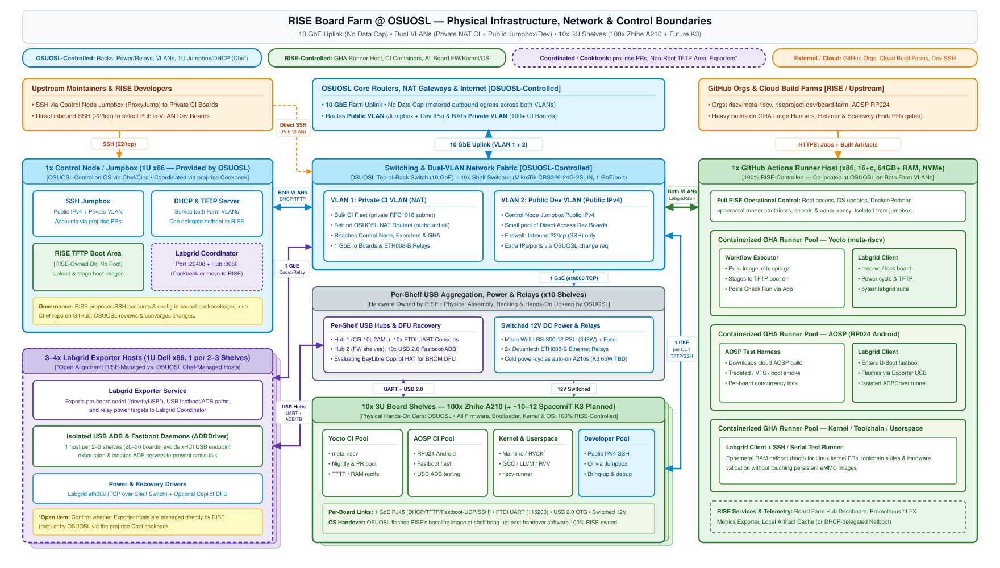
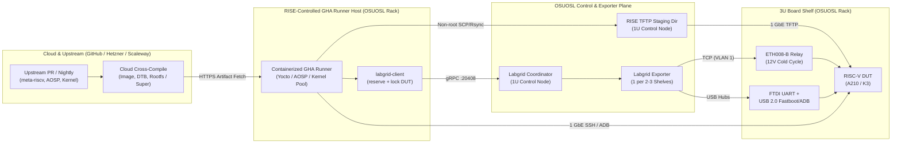

# OSUOSL Physical Infrastructure & Operational Governance (RISE vs. OSUOSL)

**Status:** Living Architecture & Governance Spec | **Authors:** [Puneetha Ramachandra](mailto:puneetha@google.com), [Ludovic Henry](mailto:luhenry@qti.qualcomm.com), [Brian Harrington](mailto:redbeard@redhat.com), [Lance Albertson](mailto:lance@osuosl.org)

## 1. Purpose

This document defines the physical rack and network topology of the **RISE RISC-V Board Farm** hosted at the **Oregon State University Open Source Lab (OSUOSL)** and establishes the operational ownership boundaries between **OSUOSL** and **RISE**.

---

## 2. Physical Infrastructure & Control Boundaries Diagram

> **Editable in Draw.io:** Both [`assets/osuosl-physical-infra.drawio`](../../assets/osuosl-physical-infra.drawio) and the rendered [`assets/osuosl-physical-infra.drawio.svg`](../../assets/osuosl-physical-infra.drawio.svg) embed the full Draw.io (`mxGraph`) diagram model. To edit for architecture discussions, drag either file onto **[https://app.diagrams.net/](https://app.diagrams.net/)**.

---

## 3. Physical & Network Architecture Breakdown

### 3.1. Network Uplinks, Bandwidth & Dual-VLAN Design (OSUOSL-Controlled)

* **Uplink & Per-Port Speeds:**
  * **10 GbE** farm uplink from the OSUOSL Top-of-Rack (ToR) switch to OSUOSL core routers.
  * **1 GbE** per board and per Ethernet relay (`ETH008-B`) to each shelf's 24-port switch (`MikroTik CRS326-24G-2S+IN`).
* **Bandwidth Policy:** No hard data cap; outbound (egress) traffic is metered across both farm VLANs (CI jobs primarily download cloud-built artifacts).
* **Dual Farm VLANs** (configured by OSUOSL on core routers and switches):
  1. **VLAN 1 — Private CI VLAN (NAT):** Houses the bulk CI board fleet (private RFC1918 subnet), Ethernet power relays, Labgrid Exporters, Control Node, and GitHub Actions Runner Host. Outbound internet access traverses OSUOSL NAT routers.
  2. **VLAN 2 — Public Developer VLAN (Public IPv4):** Carries the Control Node's public SSH Jumpbox IPv4 address plus a small, designated pool of developer boards with direct public IPv4 addresses. Inbound firewall permits **`22/tcp` (SSH) only** by default unless RISE requests additional rules.

---

### 3.2. Host Tiering & Machine Roles

To prevent resource contention, isolate CI workloads from core network services, and stay within xHCI USB controller/hub endpoint limits, x86 hosts are split into three functional tiers:

#### Tier 1: `1x Control Node / Jumpbox` (1U x86, Provided by OSUOSL — **OSUOSL-Controlled via Chef/Cinc**)
* **Services Hosted:**
  * **SSH Jumpbox:** Public IPv4 entry point (`ProxyJump`) for authorized RISE maintainers and upstream developers accessing private-VLAN boards or Labgrid tools.
  * **DHCP & TFTP Netboot Server:** Serves DHCP leases and network boot assets across both VLAN 1 (Private CI) and VLAN 2 (Public Dev). *(DHCP can also delegate netboot `next-server` to a RISE-controlled host if desired.)*
  * **RISE Non-Root TFTP / Boot Staging Area:** Dedicated filesystem path writable by RISE maintainer accounts (Unix group `rise`) allowing RISE automation and maintainers to upload kernels, DTBs, ramdisks, and OS images and re-image boards via Labgrid **without root access**.
  * **Labgrid Coordinator (`:20408`) & Board Farm Hub (`:8080`):** Central Labgrid resource broker and status/LFX Prometheus telemetry dashboard *(can remain on the Control Node via Chef cookbook or run on the RISE Runner Host)*.
* **Change Management (`proj-rise` Chef Cookbook):** Managed as code in OSUOSL's Chef (`Cinc`) infrastructure so the jumpbox/DHCP gateway remains auditable and rapidly rebuildable. OSUOSL hosts project cookbooks on GitHub under [`osuosl-cookbooks`](https://github.com/osuosl-cookbooks) (using `proj-rise` for the RISE Board Farm): RISE proposes SSH accounts, DHCP reservations, and service configuration changes via pull requests to `proj-rise`, and OSUOSL reviews and converges them.

#### Tier 2: `3–4x Labgrid Exporter Hosts` (1U Dell x86 each, 1 per 2–3 Shelves — **Exporter Hardware Access Plane**)
* **Why 1 Exporter per 2–3 Shelves (20–30 Boards):**
  * Each firmware-capable 10-board shelf uplinks **two 10-port USB hubs** (`CoolGear CG-10U2AML`): one for 10x FTDI UART serial consoles (`115200 8N1`) and a second for 10x USB 2.0 OTG (`fastboot` flashing + Android `ADB`).
  * Scaling at **1 x86 exporter host per 2–3 shelves** avoids xHCI controller endpoint/hub-depth exhaustion across 100–200 USB devices and runs isolated per-board `adb` daemons via Labgrid's `ADBDriver` to prevent cross-talk.
* **Services Hosted:**
  * `labgrid-exporter` publishing `/dev/ttyUSB*` serial ports, USB `fastboot`/`adb` device paths, and `eth008` relay power ports to the Coordinator.
* **Ownership Model:** Physical racking and USB hub cabling are handled by OSUOSL; base OS and exporter configuration can be managed either via the OSUOSL `proj-rise` Chef cookbook or directly by RISE alongside the GHA Runner Host.

#### Tier 3: `1x GitHub Actions Runner Host` (x86, 16+ Cores, 64GB+ RAM, NVMe — **100% RISE-Controlled**)
* **Co-location:** Dedicated RISE server racked by OSUOSL and connected to **both farm VLANs**.
* **Full Operational Control:** RISE holds full root, OS, container runtime (Docker/Podman), secret management, and runner lifecycle control without waiting on Chef cookbook reviews.
* **Architecture ("Build in the Cloud, Test on the Rack"):**
  * Heavy cross-compilation (Yocto `bitbake`/`kas`, AOSP `kleaf`/Android platform, GCC/LLVM) executes in the cloud (GitHub Large Hosted Runners, Hetzner x86, Scaleway).
  * Ephemeral containerized self-hosted runner pools on this host (`Yocto / meta-riscv`, `AOSP RP024`, `Kernel / Toolchain / Userspace`) download built artifacts, stage TFTP/fastboot payloads, acquire exclusive board locks via **`labgrid-client`**, execute boot/test suites (`pytest-labgrid`, Tradefed/VTS, SSH), and report statuses back to GitHub.
  * Public repository workflows gate fork PRs behind maintainer approval (`ok-to-test` label / non-fork contexts) so untrusted fork code never executes on self-hosted runners.

---

### 3.3. Per-Shelf Hardware & 100-Board DUT Fleet

* **10x Custom 3U Shelves (100x Alibaba Zhihe A210 + ~10–12 Planned SpacemiT K3):**
  * Each 3U A210 shelf houses 10 boards on custom 3D-printed carriers with fan-wall cooling, powered by a central **Mean Well LRS-350-12 (348W 12V)** PSU through a **Blue Sea 5026 12-channel fuse block** and **2x Devantech ETH008-B** 8-channel Ethernet relays (switched 12V per board for cold power-cycling auto-power-on boards).
  * **Remote Flashing & Recovery:** Normal OS/bootloader provisioning uses U-Boot TFTP (`booti`) or U-Boot `fastboot` (`fastboot usb 0` / `fastboot udp`) triggered over serial without physical button presses. Physical `BOOT_SEL0` + `Reset` BROM DFU recovery (e.g., BayLibre Copilot + Relay HAT) is under evaluation for hard-brick recovery and K3 boards.
* **Asset & Software Split:**
  * **Physical Shelves, Parts & Spares:** Owned by RISE (remains with the farm); assembled, racked, and physically maintained by OSUOSL.
  * **Board Firmware, Bootloaders, Kernels & OS Images:** **100% owned and maintained by RISE** once each shelf is handed over (OSUOSL flashes RISE's chosen baseline image during initial shelf bring-up and hands the shelf over).

---

## 4. Operational Control & Responsibility Matrix (RISE vs. OSUOSL)

| Layer / Activity | Primary Owner | OSUOSL Responsibility | RISE Responsibility | Coordination / Change Model |
| :--- | :---: | :--- | :--- | :--- |
| **Datacenter Power, Cooling, Rack & ToR Switch** | **OSUOSL** | Rack space, 10 GbE ToR switch, datacenter power & cooling | Coordinates capacity planning for new shelves or servers | Standard co-location |
| **VLANs, Core Routing, NAT & Firewall** | **OSUOSL** | Operates Private NAT VLAN & Public Dev VLAN; enforces inbound `22/tcp`-only default on Public Dev IPs | Selects which boards receive direct Public IPv4s; requests firewall/VLAN changes | Initial 2 VLANs included; later network/IP changes via OSUOSL change request |
| **Control Node OS, SSH Jumpbox & DHCP/TFTP** | **OSUOSL** *(Chef/Cinc)* | Owns 1U gateway hardware, root access, OS security updates; reviews & converges `proj-rise` cookbook PRs | Submits PRs to `osuosl-cookbooks/proj-rise` on GitHub for SSH accounts, DHCP reservations, and service tweaks | GitHub PR to `proj-rise` cookbook (major new services scoped first) |
| **TFTP / Netboot Staging Directory** | **RISE** | Exports writable non-root staging directory (group `rise`) via cookbook | Uploads kernels, DTBs, initramfs, and OS images; re-images boards via Labgrid without root | Self-service by RISE (24/7, no ticket needed) |
| **GitHub Actions Runner Host (`16+c / 64GB+`)** | **RISE** | Racks server, connects power & both farm VLANs, handles physical hands-on swap if hardware fails | **Full root & operational control**: OS, Docker/Podman runners (`Yocto`, `AOSP`, `Kernel`), `labgrid-client`, CI secrets, fork-PR gates | Self-managed by RISE |
| **Labgrid Exporter Hosts (`3–4x Dell x86`)** | *Shared / To Confirm* | Physical racking, USB hub cabling, UART/USB port mapping *(and Chef OS management if OSUOSL-managed)* | Labgrid exporter topology, `ADBDriver` isolation, board resource groups *(or full OS if RISE-managed)* | OSUOSL-cookbook vs. RISE-root model |
| **DUT Firmware, U-Boot, OpenSBI, Kernel & OS** | **RISE** | Maintains `osuosl/a210-linux` on Shelf 1 only until Shelf 1 handover; flashes RISE's baseline image at shelf bring-up | **100% ownership** of OpenSBI, U-Boot, Linux/Android/Yocto kernels, rootfs images, and CI provisioning | Self-managed by RISE post-handover |
| **Shelf Hardware, Relays, PSUs & USB Hubs** | **RISE** *(Asset)* / **OSUOSL** *(Hands-on)* | Shelf assembly, inspection, racking, and hardware bring-up | Owns shelves, relays, hubs, boards, and fleet spares; supplies replacement boards/spares | Scoped per shelf build-out |
| **Routine Physical Board Care** | **OSUOSL** | Power cycling, reseating cables/USB, swapping failed boards from spares, keeping consoles/network up | Flags stuck/dead hardware via Labgrid / Hub metrics | Routine monthly hands-on allowance included in co-location; excess non-urgent care pre-approved by RISE |
| **Urgent Shelf-Down Repairs & Fleet Faults** | **OSUOSL** *(w/ Cap)* | Starts urgent repairs **immediately without waiting** when a shelf is down (up to a pre-agreed monthly hour cap), reporting within 1 week | Reviews incident report; approves extended repairs or fleet-fault root-cause investigations (≥3 boards in 30 days) | Pre-authorized emergency window; extended work requires written RISE approval |
| **Hardware / Shelf Modifications (JTAG, K3, Copilot)** | **Coordinated** | Evaluates PSU/fuse/thermal impact (e.g., K3 65W vs. A210 18W) and executes approved hardware changes | Defines requirements (e.g., Copilot DFU HAT, JTAG headers, new board carrier) and approves scope | Scoped & approved in writing before work starts |

---

## 5. Standard Operational Flows

1. **Adding/Removing Developer SSH or Labgrid Access:**
   * A RISE tech lead opens a PR against the `osuosl-cookbooks/proj-rise` Chef cookbook on GitHub adding the contributor's SSH public key and group membership (`rise`). OSUOSL reviews and converges Chef/Cinc on the Control Node.
2. **Updating Boot Images or Re-imaging a Shelf:**
   * RISE CI or maintainers upload kernel/DTB/rootfs artifacts directly to the RISE-owned TFTP staging directory on the Control Node (no root required) and trigger `labgrid-client` over UART/U-Boot (`tftpboot` or `fastboot`) to boot in RAM or flash eMMC.
3. **Requesting Infrastructure Changes (VLANs, Public IPs, Hardware Mods):**
   * RISE submits an infrastructure change request to OSUOSL; OSUOSL scopes the engineering/hardware impact and executes upon written RISE approval.
